# Лабораторна робота №1. Знайомство з Vue.js 3 (Composition API)

To-Do застосунок на Vue.js 3 (`<script setup>`, Composition API) та Vite.

## Кроки запуску

1. Створення проєкту:

```sh
npm create vue@latest
```

Обрано: без TypeScript, без додаткових функцій, порожній проєкт без прикладів коду.

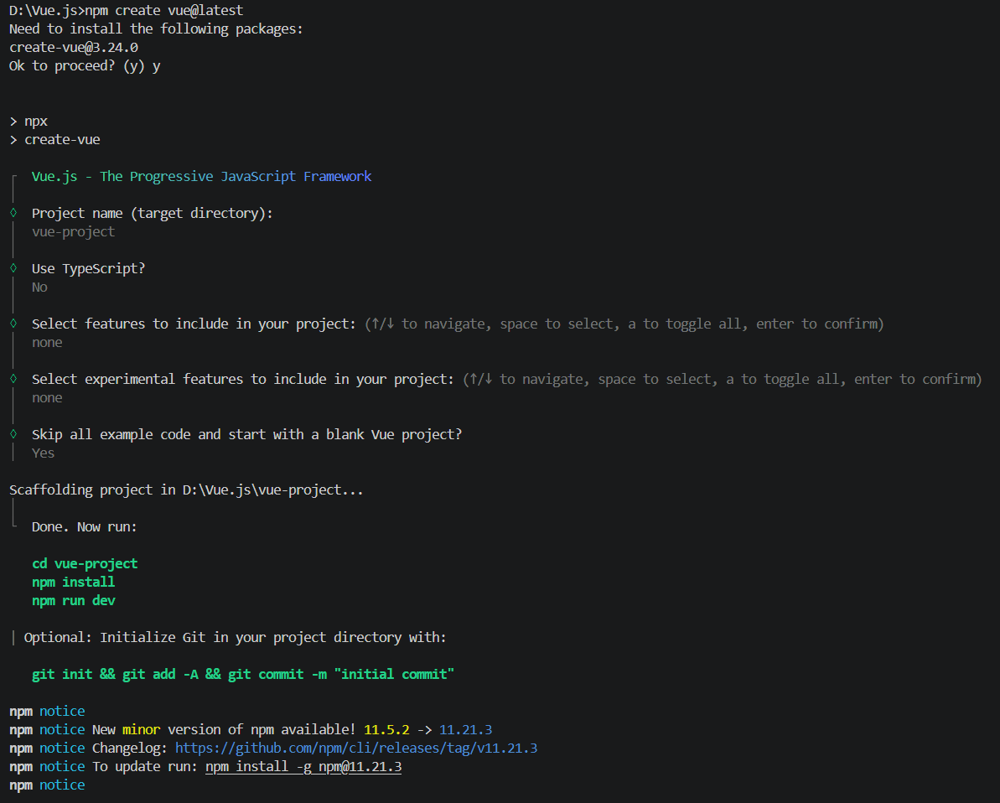

2. Встановлення залежностей:

```sh
cd lab1
npm install
```

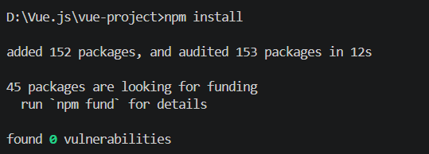

3. Запуск dev-сервера:

```sh
npm run dev
```

Застосунок доступний на http://localhost:5173/, Vue DevTools - на http://localhost:5173/__devtools__/.

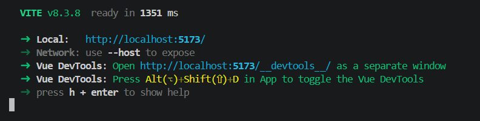

4. Збірка для production:

```sh
npm run build
```

## Vue DevTools

Плагін `vite-plugin-vue-devtools` є у `devDependencies` та підключений у `vite.config.js`.
Для коректного відкриття IDE (VS Code) при кліку на компонент у DevTools задано параметр `launchEditor`:

```js
vueDevTools({
  launchEditor: 'code',
})
```

## Використані залежності

- `vue` 3
- `vite`, `@vitejs/plugin-vue`, `vite-plugin-vue-devtools`
- `@vuepic/vue-datepicker` - вибір дат у фільтрах (разом із `date-fns` для української локалі)

## Структура проєкту

```
src/
  App.vue                       - стан, computed, watch, логіка
  main.js
  assets/main.css               - загальні стилі
  components/
    TodoForm.vue                - форма додавання завдання
    TodoFilters.vue             - фільтри
    TodoItem.vue                - картка завдання (перемикання, редагування, видалення)
    TodoPagination.vue          - пагінація
```

## Модель даних

```js
{
  id: number,
  title: string,
  description: string,
  status: 'active' | 'done',
  createdAt: string,            // ISO дата
  priority: 'low' | 'medium' | 'high',
}
```

## Де застосовано ref / reactive, computed, watch

### ref

Примітивний стан створено через `ref` (у script значення доступні через `.value`):

- `App.vue`: `todos` - список завдань, `page` - поточна сторінка.
- `TodoForm.vue`: `error`.
- `TodoItem.vue`: `isEditing`, `error`.

### reactive

Об'єктний стан створено через `reactive` (доступ без `.value`, очищення через `Object.assign`):

- `App.vue`: `filters` - об'єкт фільтрів (передається в `TodoFilters.vue` через prop, поля прив'язані через `v-model`).
- `TodoForm.vue`: `form` - поля форми додавання.
- `TodoItem.vue`: `draft` - чернетка під час редагування.

### computed

`App.vue`:

- `totalCount`, `activeCount`, `doneCount` - лічильники «всього», «активних», «виконаних»;
- `filteredTodos` - список після застосування фільтрів;
- `hasActiveFilters` - чи є активні фільтри (для кнопки «Очистити фільтри»);
- `pageCount` - кількість сторінок;
- `pagedTodos` - завдання поточної сторінки.

`TodoItem.vue`: `createdAtText` - відформатована дата створення.

### watch

- `watch(todos, ..., { deep: true })` в `App.vue` - при будь-якій зміні списку (додавання, зміна
  статусу, редагування, видалення) записує його в LocalStorage. На старті список зчитується з
  LocalStorage функцією `loadTodos()`.
- `watch(filters, ..., { deep: true })` - при зміні фільтрів повертає на першу сторінку.
- `watch(pageCount, ...)` - якщо після видалення поточної сторінки більше немає, переходить на
  останню наявну.

## Директиви

| Директива | Де використана |
| --- | --- |
| `v-model` | Поля форми додавання (`TodoForm.vue`), поля фільтрів та календарі (`TodoFilters.vue`), поля редагування (`TodoItem.vue`), `defineModel` для сторінки |
| `v-on` / `@` | `@submit.prevent` у формі, `@click` на кнопках (додати, видалити, редагувати, зберегти, очистити фільтри, пагінація), `@change` на чекбоксі статусу |
| `v-bind` / `:` | `:checked`, `:title`, `:class` у `TodoItem.vue`, `:disabled` на кнопках, `:key`, `:todo`, `:page-count`, `:min-date`, `:max-date`, `:locale` у календарях |
| `v-for` | Список завдань у `App.vue`, кнопки сторінок у `TodoPagination.vue` |
| `v-if` / `v-else-if` / `v-else` | Показ списку чи повідомлення про порожній список / відсутність результатів, режим перегляду/редагування у `TodoItem.vue`, повідомлення про помилку, пагінація |
| `v-show` | Підпис «виконано» / «активне» у картці завдання |

## Функціонал

### Додавання

Нове завдання потрапляє на початок списку зі статусом `active`. Якщо назва або опис порожні,
завдання не додається, показується повідомлення про помилку.

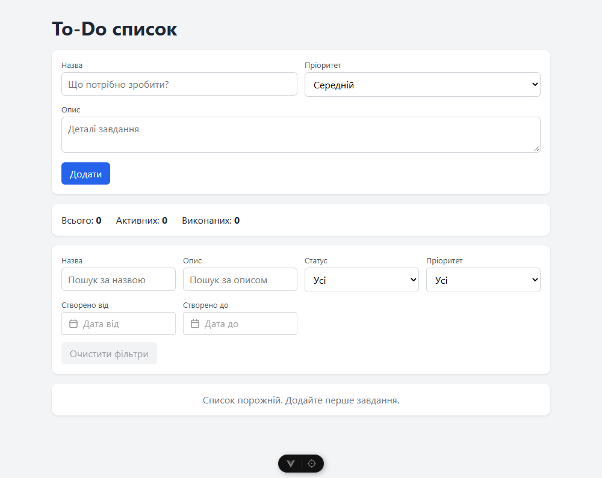
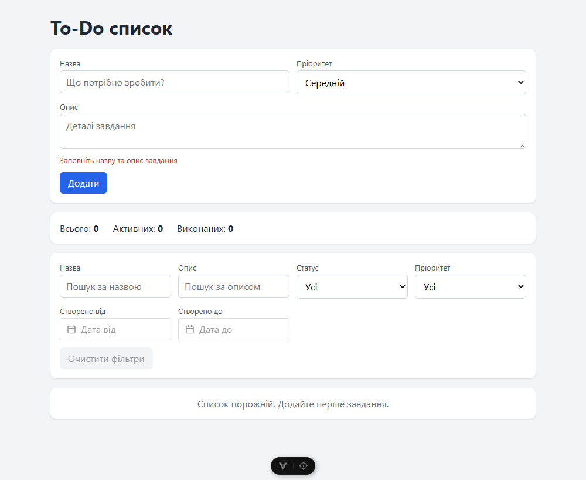


### Зміна статусу та лічильники

Чекбокс перемикає статус `active` / `done`. Лічильники «Всього / Активних / Виконаних» обчислюються
через `computed`.

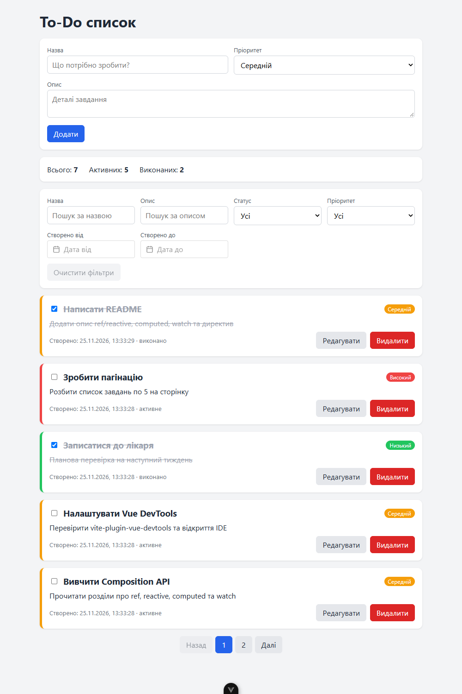

### Пагінація

На сторінці відображається по 5 завдань.

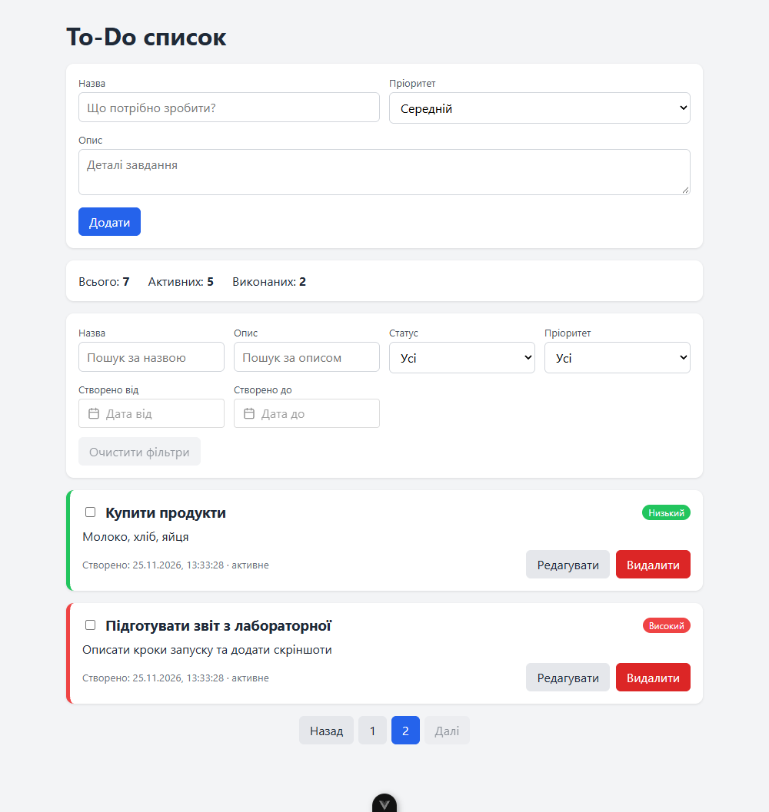

### Редагування

Кнопка «Редагувати» перемикає картку в режим редагування назви, опису та пріоритету.

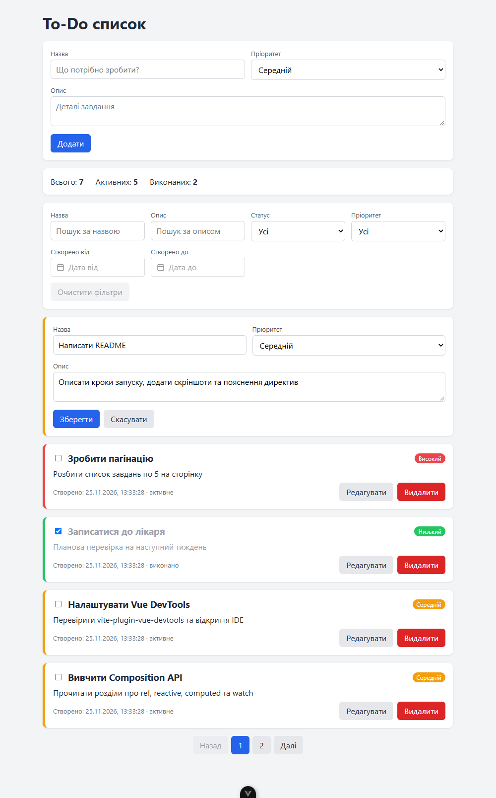

### Фільтрація

Фільтри за назвою, описом, статусом, пріоритетом та датою створення (від / до). Для вибору дати
використано `@vuepic/vue-datepicker`. Кнопка «Очистити фільтри» скидає всі фільтри.

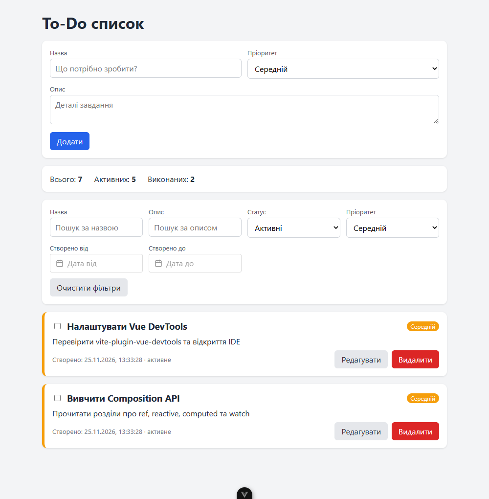
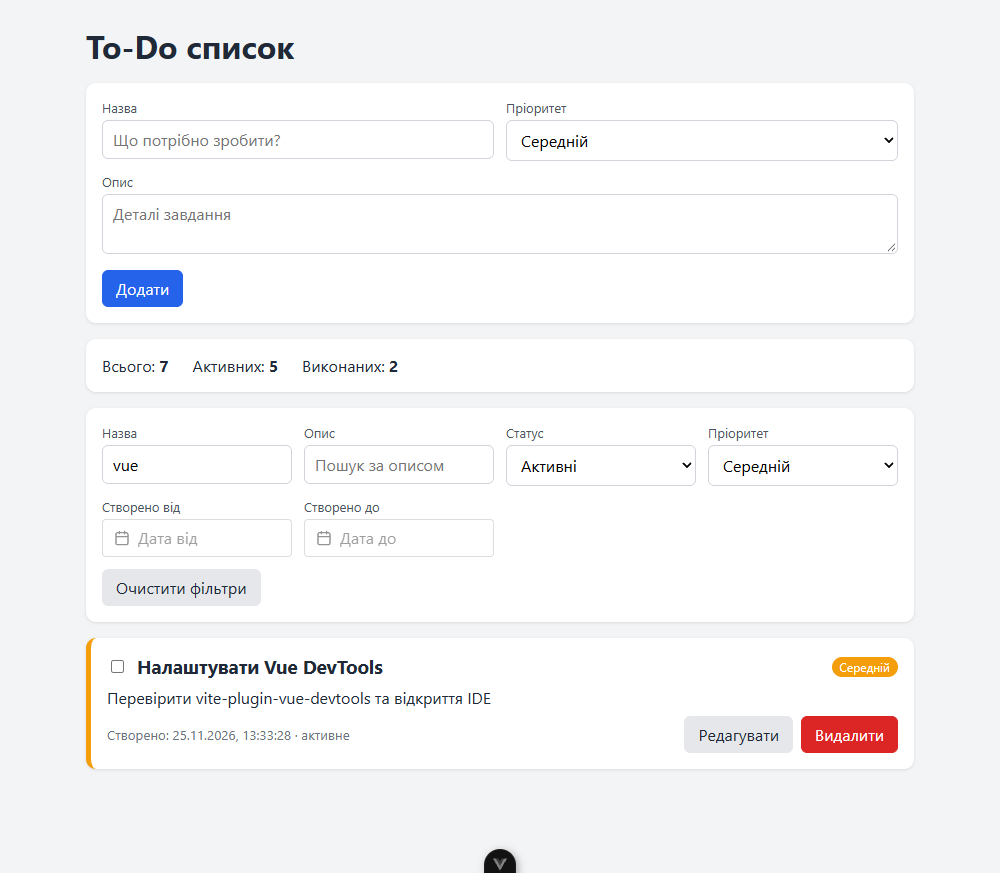
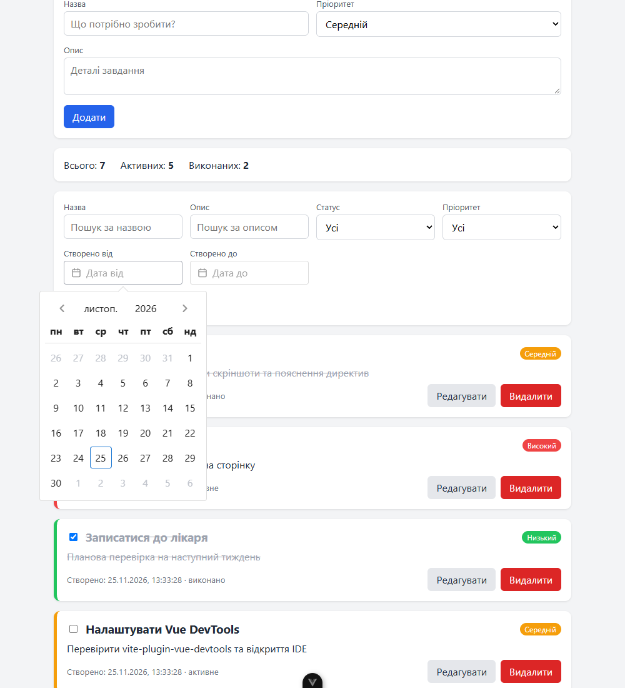
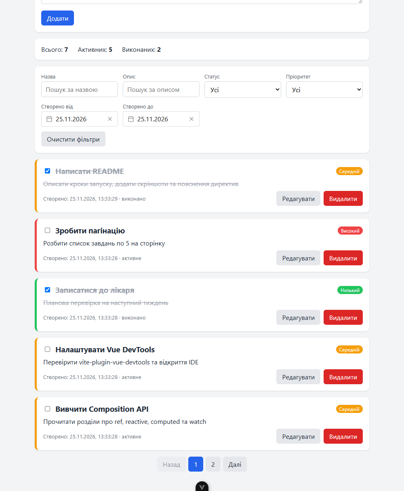

### Видалення

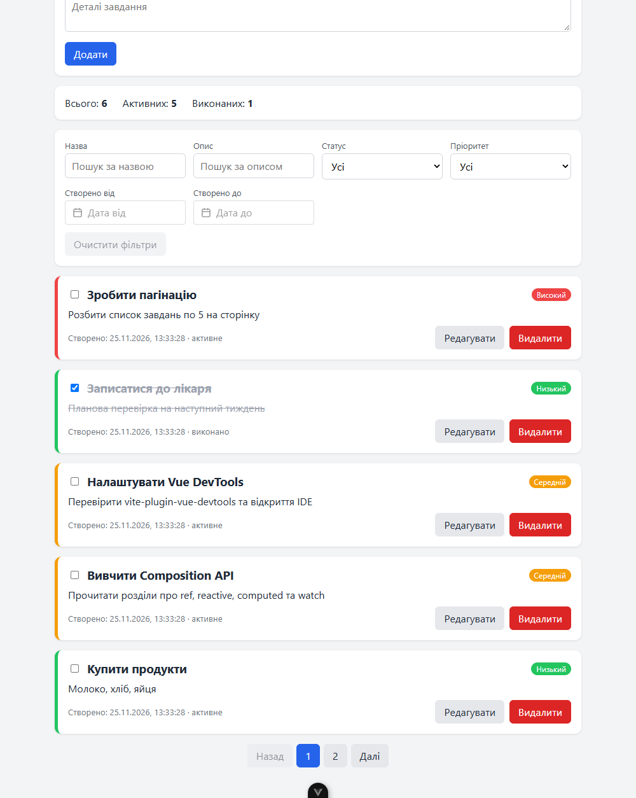

### LocalStorage

Список зберігається під ключем `lab1-todos` і відновлюється після перезавантаження сторінки.
