# Лабораторна робота №2. Взаємодія між компонентами та роутинг у Vue.js

Прототип адмін-панелі з імітованою автентифікацією на Vue 3 (Composition API), Vue Router 4 та Vite.
Бекенд імітується локально: користувачі та сесія зберігаються в LocalStorage.

## Кроки запуску

1. Створення проєкту (обрано Router та Prettier, без TypeScript, порожній проєкт):

```sh
npm create vue@latest
```

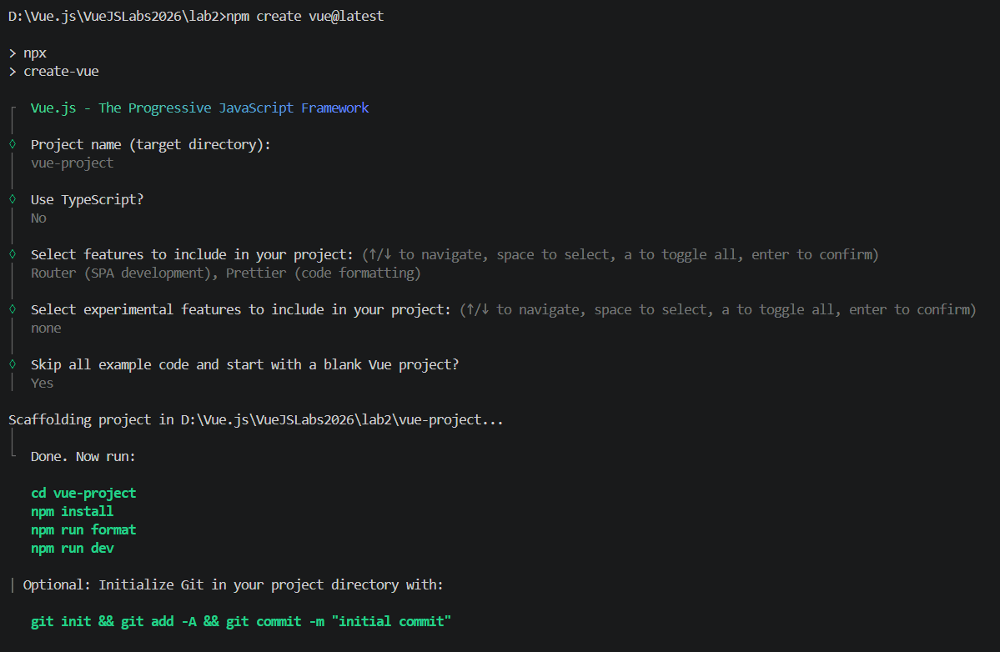

2. Встановлення залежностей:

```sh
cd vue-project
npm install
```

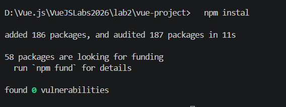

3. Запуск dev-сервера:

```sh
npm run dev
```

4. Збірка:

```sh
npm run build
```

Демо-акаунт адміністратора: `admin@example.com` / `admin123`. Нових користувачів можна створити через форму реєстрації.

## Структура проєкту

```
src/
  main.js
  App.vue                         - provide даних про користувача, RouterView
  router/index.js                 - маршрути, guard, налаштування роутера
  composables/useAuth.js          - імітація автентифікації (LocalStorage)
  components/
    BaseInput.vue                 - інпут з defineModel
    AuthLayout.vue                - обгортка для Login/Register (слоти)
    LoginForm.vue, RegisterForm.vue
    BaseCard.vue                  - картка зі слотами header/footer
    UserTable.vue, UserRow.vue    - таблиця користувачів
  views/
    HomeView.vue, LoginView.vue, RegisterView.vue, NotFoundView.vue
    admin/
      AdminLayout.vue, DashboardView.vue, UsersView.vue,
      UserDetailsView.vue, ReportsView.vue
```

## Роутинг

| Шлях | Компонент | Meta |
| --- | --- | --- |
| `/` | HomeView | `public: true` |
| `/login` | LoginView | `public: true` |
| `/register` | RegisterView | `public: true` |
| `/admin` | AdminLayout (редірект на `/admin/dashboard`) | `requiresAuth: true` |
| `/admin/dashboard` | DashboardView | |
| `/admin/users` | UsersView | |
| `/admin/user/:id` | UserDetailsView | |
| `/admin/reports` | ReportsView | |
| `/:pathMatch(.*)*` | NotFoundView | `public: true` |

- Усі сторінки підключені через динамічний імпорт `() => import(...)` (lazy-loading), тому при збірці кожна
  потрапляє в окремий чанк.
- Налаштування роутера: `createWebHistory`, `scrollBehavior` (повертає `{ top: 0 }`, при переході скролить вгору),
  `linkActiveClass: 'active'` (активне посилання в навігації підсвічується в `AdminLayout.vue`).
- Guard `beforeEach` у `router/index.js`: якщо маршрут (або його батько) має `meta.requiresAuth`, а користувач не
  авторизований, виконується редірект на `/login?redirect=<шлях>`. Після входу користувача повертає на
  запрошену сторінку. Авторизованого користувача зі сторінок `/login` та `/register` перенаправляє в адмін-панель.
- `/admin/user/:id` має `props: true`, тому `id` приходить у `UserDetailsView` як prop.

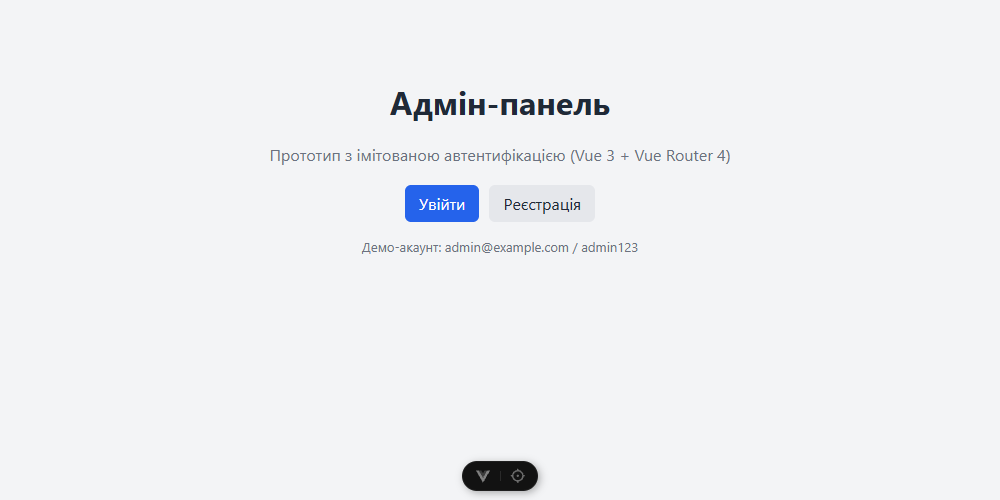
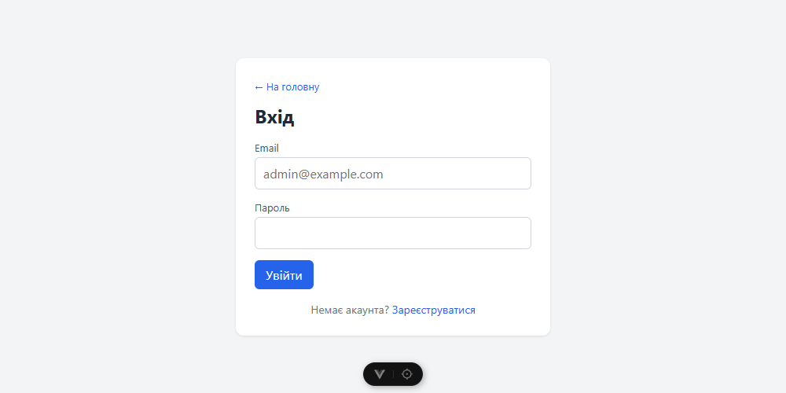
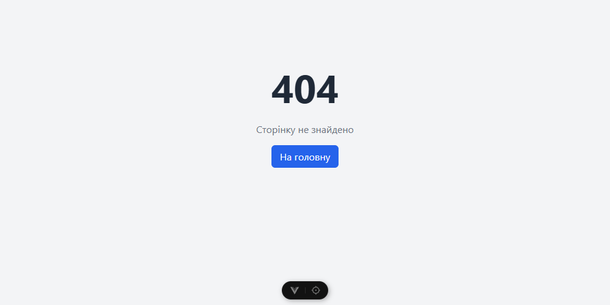

## Автентифікація

### Login

Поля email і password, валідація: обов'язкові поля, формат email, пароль мінімум 6 символів.
Помилка «бекенду» (невірний email або пароль) показується над формою.

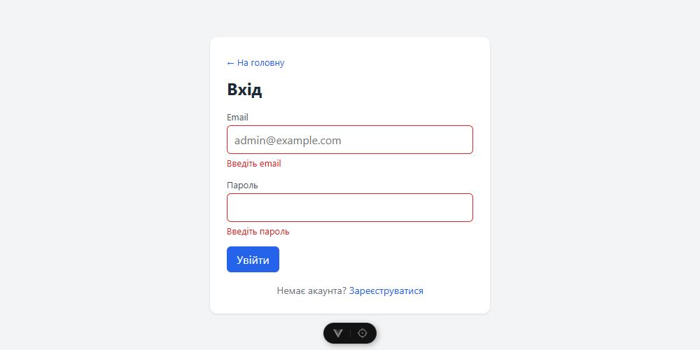
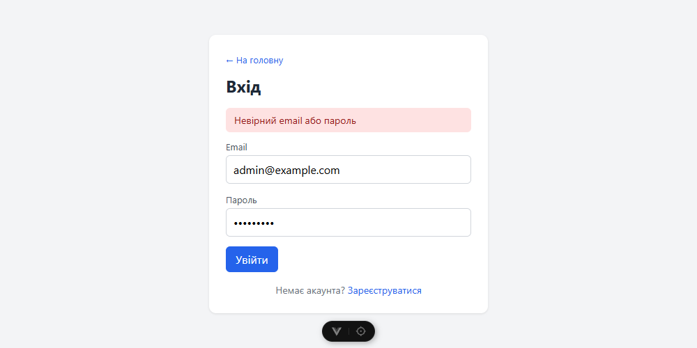

### Register

Поля name, email, password, confirmPassword. Перевіряється збіг паролів та унікальність email.

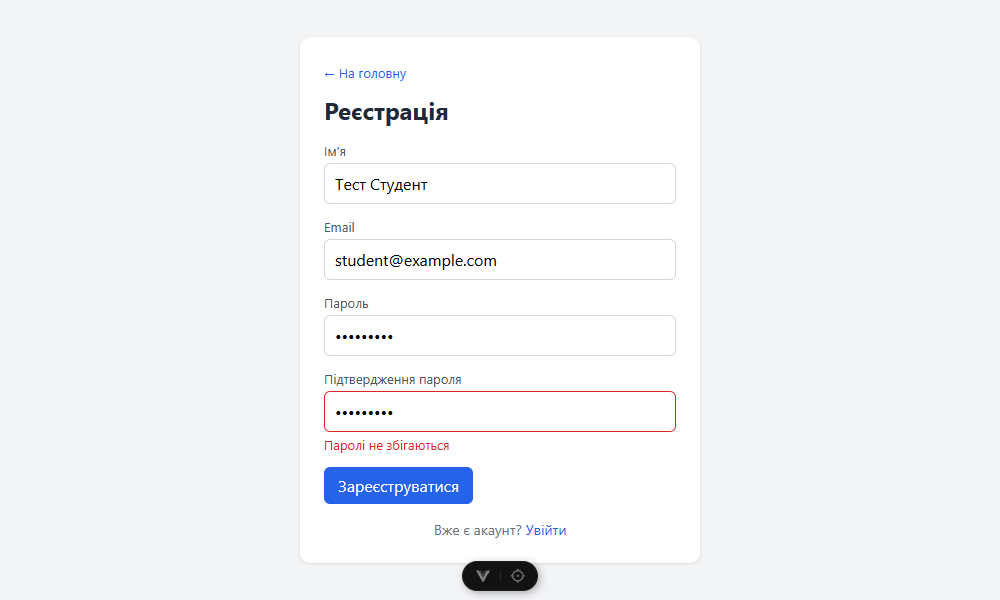

### Admin

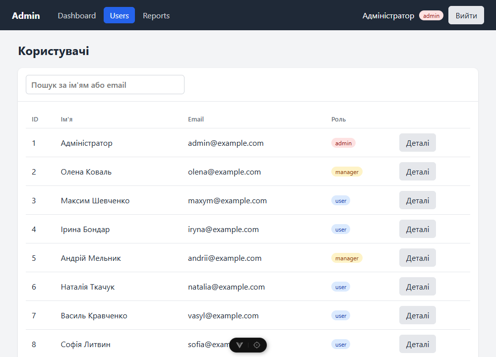
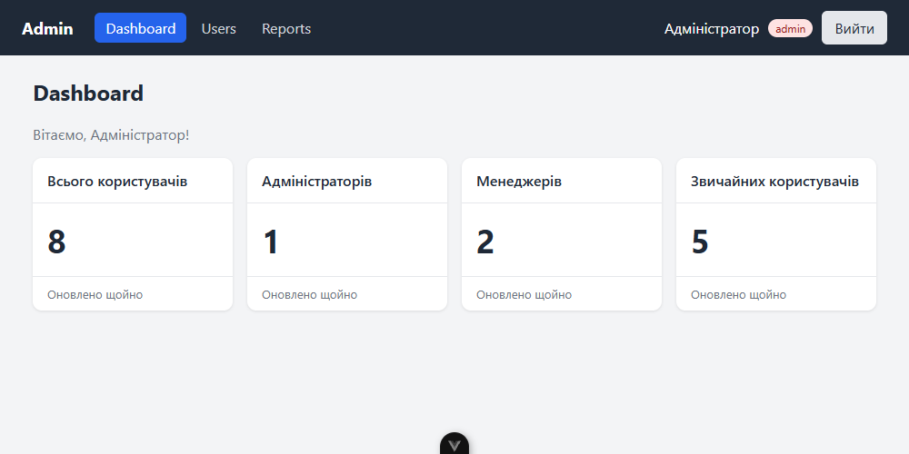
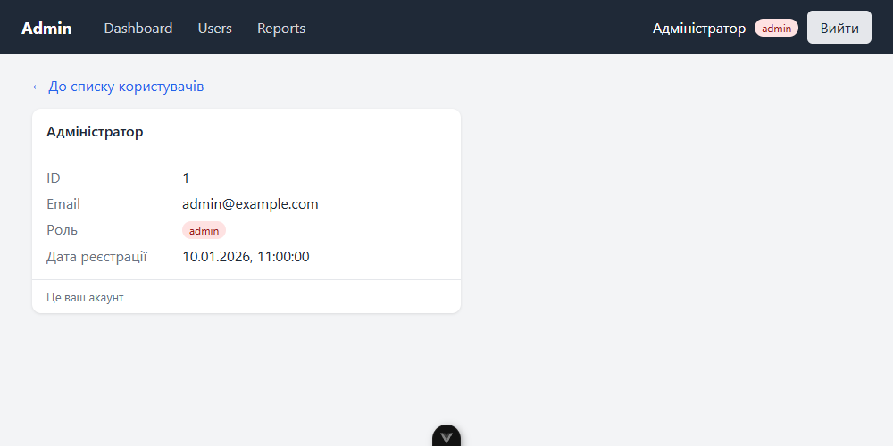
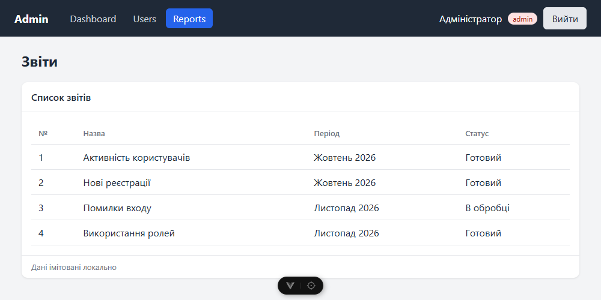
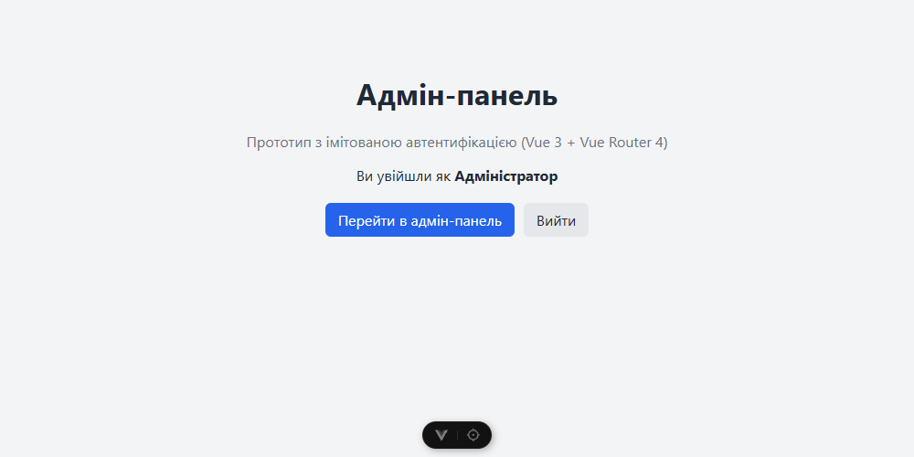

## Де застосовано

### props / emits

Ланцюжок `UsersView -> UserTable -> UserRow`:

- `UsersView` передає в `UserTable` список через prop `users`, `UserTable` передає кожного користувача в `UserRow`
  через prop `user`.
- Кнопка «Деталі» в `UserRow` викликає `emit('select', id)`, `UserTable` перевипромінює цю подію вгору, а `UsersView`
  у обробнику `openUser` виконує перехід на `/admin/user/:id`.

Також:

- `LoginForm` / `RegisterForm`: prop `serverError` (помилка з батьківського компонента) та подія `submit` з даними форми.
- `UserDetailsView`: prop `id` з параметра маршруту.
- `BaseInput`: props `label`, `type`, `placeholder`, `autocomplete`, `error` та подія `blur`.

### v-model / defineModel

`BaseInput.vue` використовує `defineModel` (`const model = defineModel()`), тому в формах поля підключаються як
`<BaseInput v-model="form.email" />`. Інпут-компонент використано в `LoginForm` та `RegisterForm`.

### provide / inject

- `App.vue` викликає `provide(AUTH_KEY, useAuth())`, передаючи дані про авторизованого користувача та методи
  `login`, `register`, `logout`.
- Через `inject(AUTH_KEY)` дані читаються в `HomeView` (умовно показує «Увійти / Реєстрація» або ім'я користувача та
  кнопку «Вийти»), `AdminLayout` (ім'я користувача, бейдж `admin` через `v-if="auth.isAdmin.value"`, вихід),
  `DashboardView`, `UsersView`, `UserDetailsView`, `LoginView`, `RegisterView`.

### Слоти

- `AuthLayout.vue` - обгортка для Login/Register: іменований слот `title`, основний слот (форма) та слот `footer`
  (посилання на сусідню форму). Використовується в `LoginView` та `RegisterView` через `<template #title>` і
  `<template #footer>`.
- `BaseCard.vue` - слоти `header`, основний та `footer` (відображаються за допомогою `$slots`). Використовується в
  Dashboard, Users, UserDetails та Reports.

### Vue Router

`RouterView` у `App.vue` (верхній рівень) та в `AdminLayout.vue` (вкладені маршрути), `RouterLink` для навігації,
`useRouter` / `useRoute` для програмних переходів та читання `query.redirect`, guard `beforeEach`.
