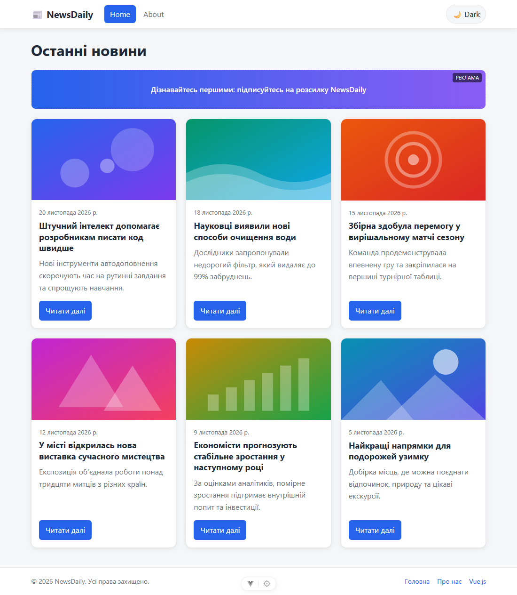
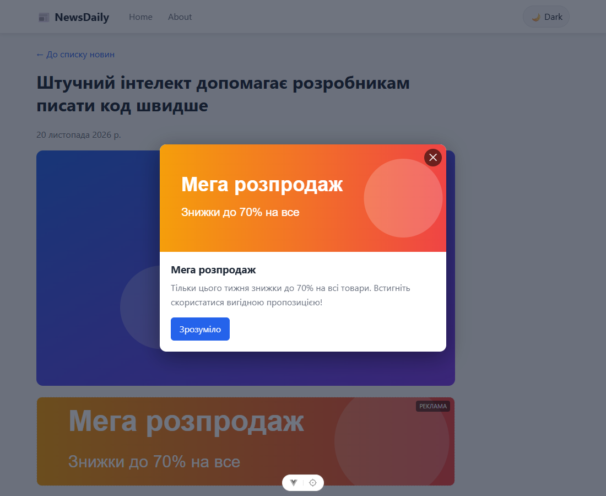
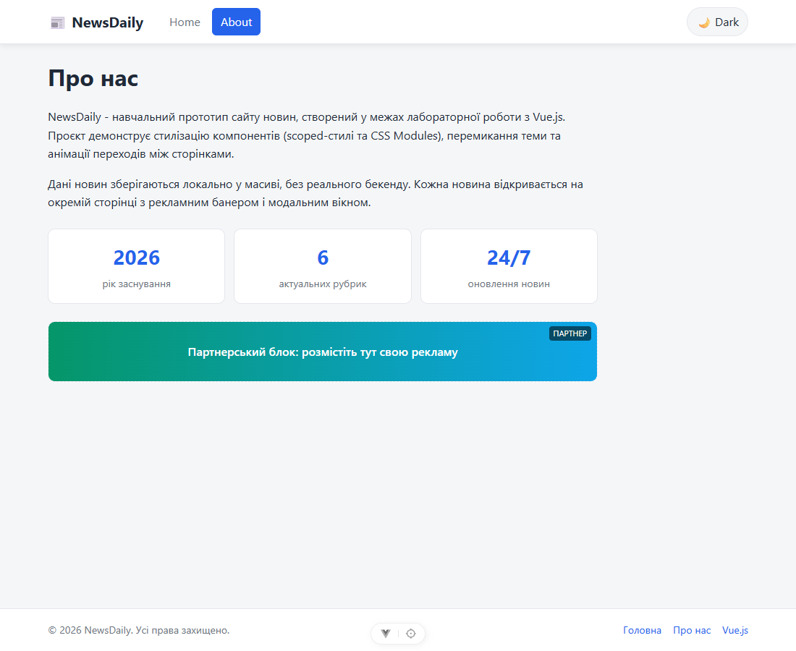
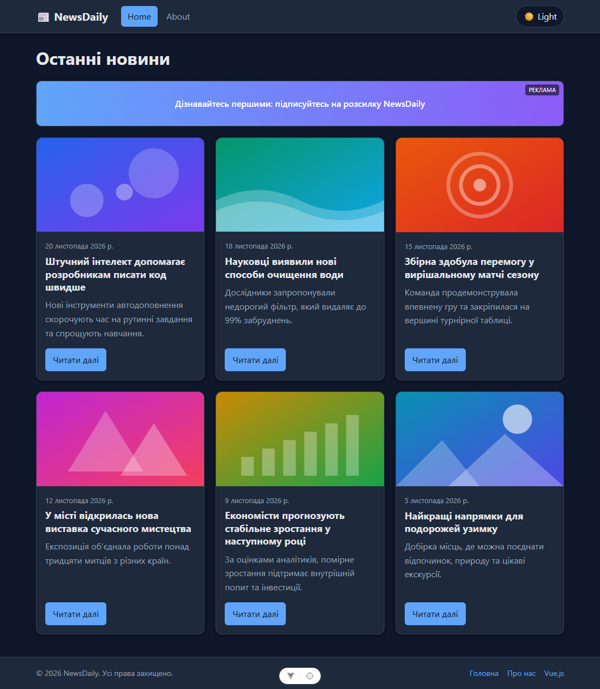
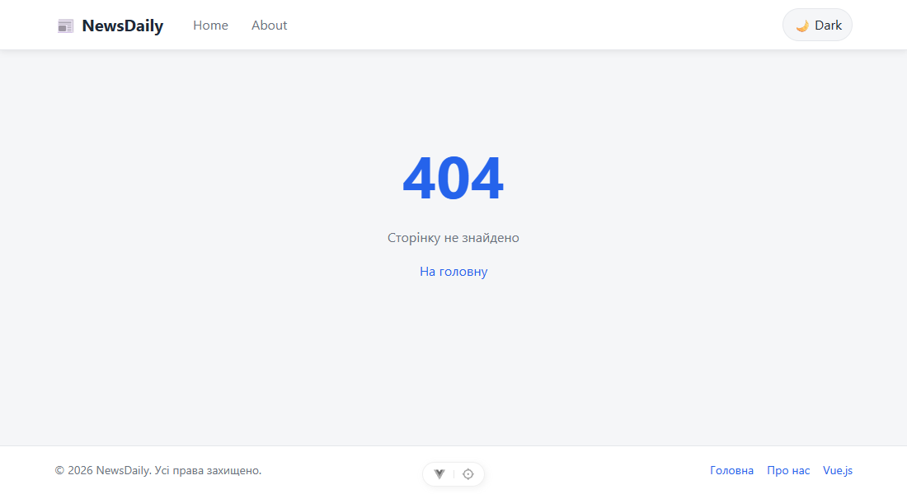

# Лабораторна робота №3. Стилізація компонентів у Vue.js

Прототип сайту новин (NewsDaily) на Vue 3 (Composition API), Vue Router 4 та Vite: список новин, сторінка новини,
сторінка «Про нас», рекламні слоти з модальним вікном, перемикач теми та анімації переходів між сторінками.
Дані новин беруться з локального масиву (`src/data/news.js`).

## Кроки запуску

```sh
cd lab3/vue-project
npm install
npm run dev
```

Застосунок відкривається на http://localhost:5173/ (порт може відрізнятись, його покаже Vite).

Збірка для production:

```sh
npm run build
```

## Структура проєкту

```
src/
  main.js
  App.vue                         - лейаут, RouterView у Transition
  assets/
    main.css                      - CSS-змінні тем та базові стилі
    images/                       - зображення новин та реклами (svg)
  data/news.js                    - локальні дані новин
  composables/useTheme.js         - логіка перемикача теми
  router/index.js
  components/
    AppHeader.vue, AppFooter.vue, ThemeToggle.vue
    AdSlot.vue                    - рекламний слот (слот + клікабельний режим)
    AdModal.vue + AdModal.module.css     - модальне вікно реклами
    NewsCard.vue + NewsCard.module.css   - картка новини
  views/
    HomeView.vue, ArticleView.vue, AboutView.vue, NotFoundView.vue
```

## Маршрути

| Шлях | Сторінка |
| --- | --- |
| `/` | Головна, список новин |
| `/article/:id` | Повна новина |
| `/about` | Про нас |
| `/:pathMatch(.*)*` | NotFound |

Налаштування роутера: `createWebHistory`, `scrollBehavior` (повертає `{ top: 0 }`, тому при переході сторінка
скролиться вгору), `linkActiveClass: 'active'` (активний пункт меню в хедері підсвічується; для пункту Home
використано `exact-active-class`, щоб він не був активним на всіх сторінках).

## Реалізація

### Хедер, футер, лейаут

Хедер (`AppHeader.vue`): логотип, навігація Home / About, перемикач теми. Футер (`AppFooter.vue`): копірайт та
посилання. Лейаут у `App.vue` - flex-колонка, футер притиснутий донизу.



### Список новин

`HomeView.vue` через `v-for` виводить `NewsCard` для кожної новини: картинка, дата, заголовок, короткий опис та
кнопка «Читати далі», що веде на `/article/:id`.

### Сторінка новини та реклама

`ArticleView.vue` отримує `id` через prop (`props: true` у маршруті) і показує заголовок, дату, зображення та
текст. Банер «Реклама» (`AdSlot` з `clickable`) по кліку відкриває модальне вікно `AdModal`.




### Рекламні слоти

`AdSlot.vue` має слот за замовчуванням (вміст передає батьківський компонент, є fallback) та props `clickable`,
`label`. Статичні слоти використано на двох сторінках: головній (`HomeView`) та «Про нас» (`AboutView`), клікабельний -
на сторінці новини.



### Перемикач теми

`useTheme.js` зберігає тему в `ref`, через `watch` записує її в `data-theme` на `<html>` та в `localStorage`
(ключ `lab3-theme`). Початкове значення - з `localStorage`, а якщо там порожньо - з `prefers-color-scheme`.
Кольори задано CSS-змінними в `main.css` (`:root` та `:root[data-theme='dark']`), тож компоненти просто
використовують `var(--bg)`, `var(--text)` тощо. Після перезавантаження обрана тема зберігається.



### Анімації переходів

У `App.vue` `<RouterView>` обгорнуто в `<Transition mode="out-in">` з `:key="route.path"`. Для `Transition` без
`name` описано базові класи `v-enter-from`, `v-enter-active`, `v-enter-to`, `v-leave-from`, `v-leave-active`,
`v-leave-to` (плавна зміна `opacity` та зсув по осі Y).

Модальне вікно (`AdModal.vue`) також у `<Transition name="modal">` (класи `modal-*`): фон плавно з'являється, а саме
вікно додатково масштабується. Вікно відкривається в `<Teleport to="body">`, закривається по кліку на фон, хрестику,
кнопці та клавіші Esc.



## Стилізація: SFC, scoped та CSS Modules

| Підхід | Де застосовано |
| --- | --- |
| `<style scoped>` | `App.vue`, `AppHeader.vue`, `AppFooter.vue`, `ThemeToggle.vue`, `AdSlot.vue`, `HomeView.vue`, `ArticleView.vue`, `AboutView.vue`, `NotFoundView.vue` |
| CSS Modules (`.module.css`) | `NewsCard.vue` + `NewsCard.module.css`, `AdModal.vue` + `AdModal.module.css` |
| Глобальні стилі та CSS-змінні | `assets/main.css` |
| Глобальний `<style>` у компоненті | клас переходу `modal-*` в `AdModal.vue` |

Порядок каскаду: спочатку в `main.css` оголошуються змінні тем і базові стилі елементів (`body`, `a`, `h1`, `img`),
потім підключаються стилі компонентів, які мають вищу специфічність за рахунок атрибутів `data-v-xxxx` (scoped) або
унікальних імен класів (modules) і тому перекривають глобальні.

## Висновок

У Vue стилі можна описувати прямо в компоненті (SFC) і керувати їх областю дії. `<style scoped>` додає до елементів
компонента унікальний атрибут `data-v-*` і переписує селектори так, щоб вони діяли тільки в межах компонента,
тому класи з однаковими назвами у різних компонентах не конфліктують. Це зручно й просто, але є нюанси: стилі
батька потрапляють лише на кореневий елемент дочірнього компонента, для вмісту слотів потрібен `:slotted()`,
для глибоких селекторів - `:deep()`, а гібрид scoped та глобальних стилів ускладнює відстеження каскаду.

CSS Modules генерують унікальні імена класів на етапі збірки, їх імпортують як об'єкт (`styles.card`) і прив'язують
через `:class`. Вони повністю усувають колізії імен, дозволяють виносити стилі в окремий файл і добре підходять для
перевикористовуваних компонентів (картка, модалка), але трохи складніші в записі та не підтримують звичайні імена
класів у шаблоні.

Для тем найзручніше використати CSS-змінні: стилі компонентів не залежать від конкретної теми, а перемикання зводиться
до зміни атрибута `data-theme` на кореневому елементі, при цьому змінні успадковуються і працюють як у scoped-стилях,
так і в CSS Modules. Анімації реалізуються через вбудований компонент `<Transition>`, який лише додає та видаляє
CSS-класи на потрібних етапах, а сам вигляд переходу описується звичайним CSS. Класи переходу не належать модулю чи
scope, тому їх оголошують або в стилях компонента, де розміщений `Transition` (scoped діє на кореневий елемент
дочірнього компонента), або в глобальному блоці. Загалом комбінація scoped-стилів для сторінок і лейаутів, CSS Modules
для самостійних компонентів та CSS-змінних для тем дає передбачуваний каскад і легку підтримку проєкту.
