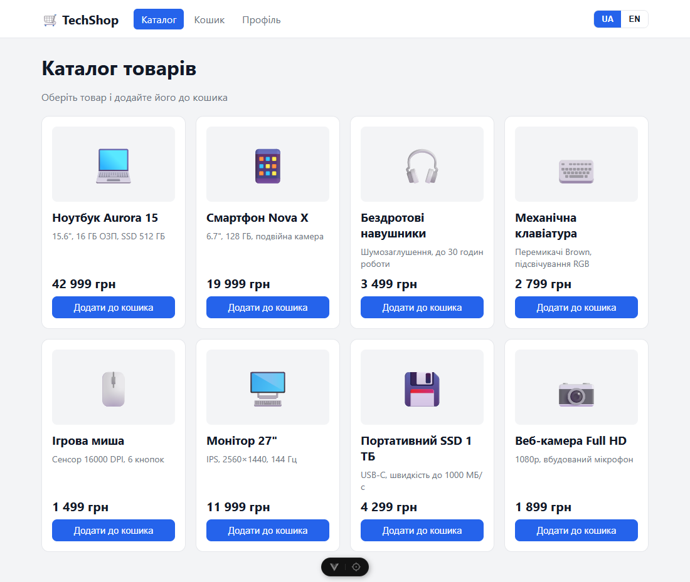
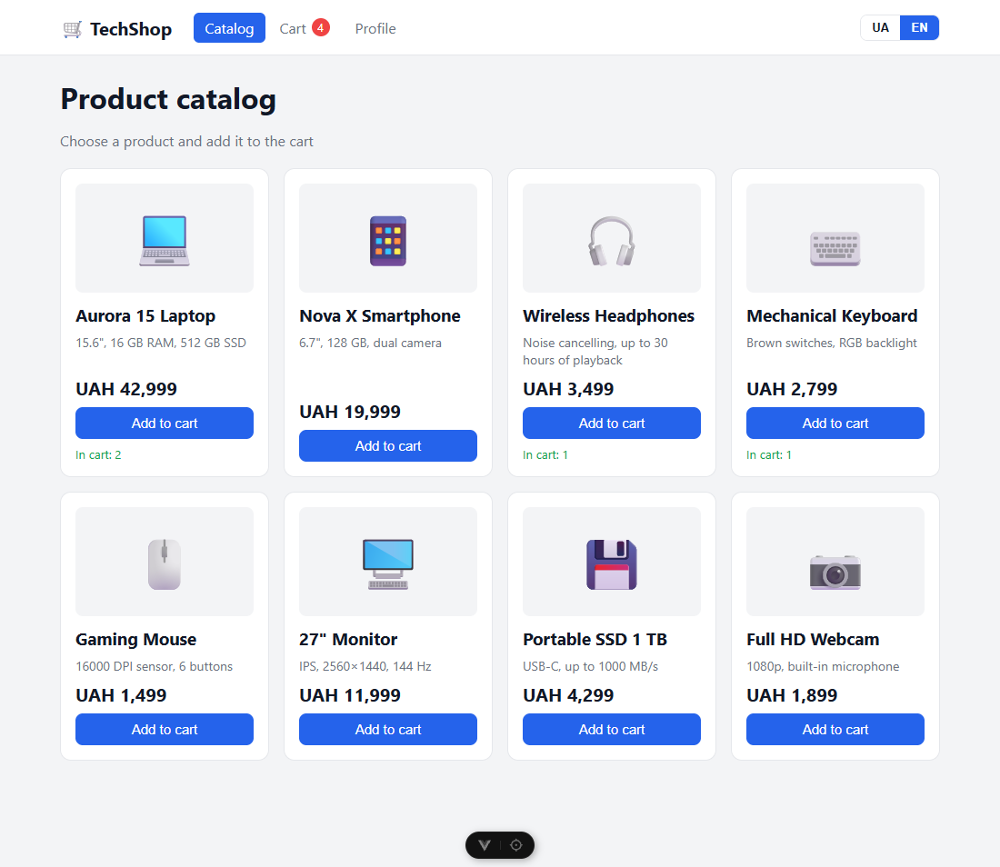
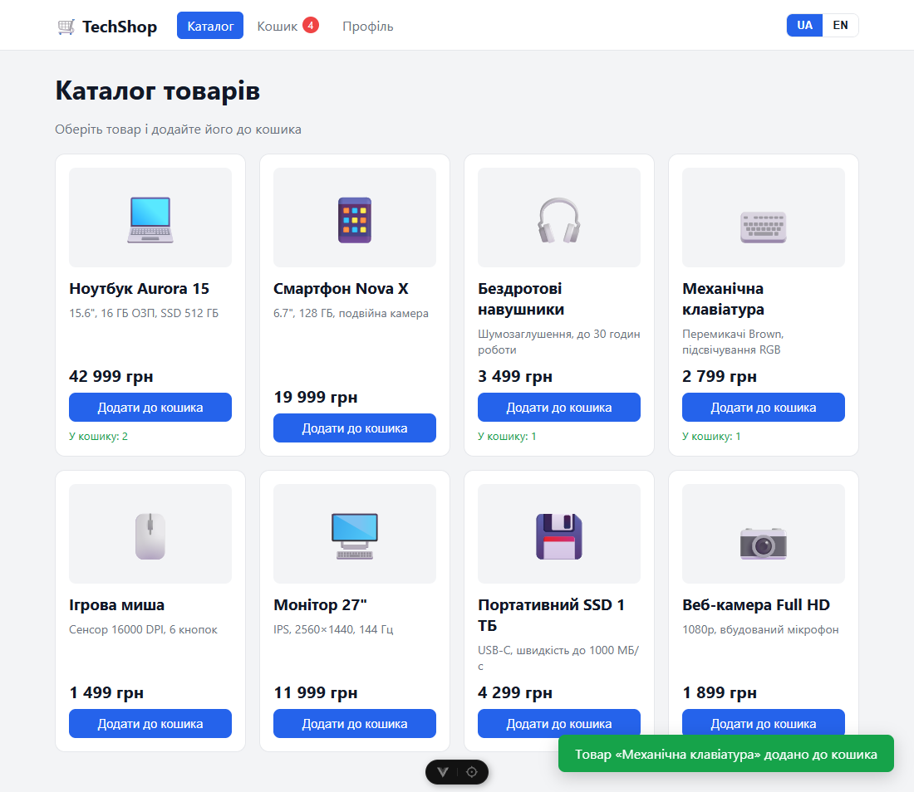
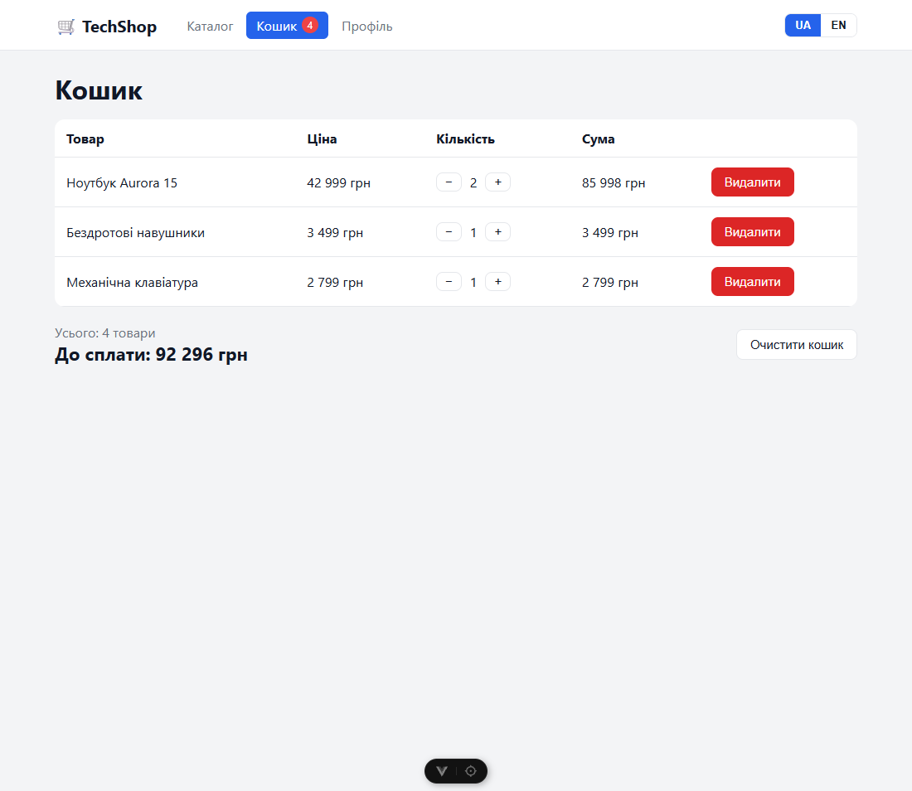
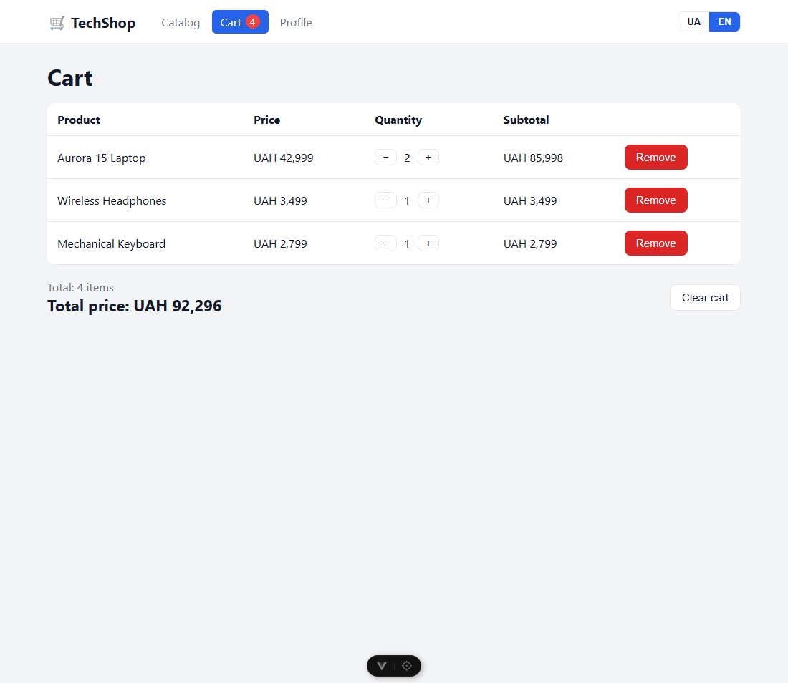
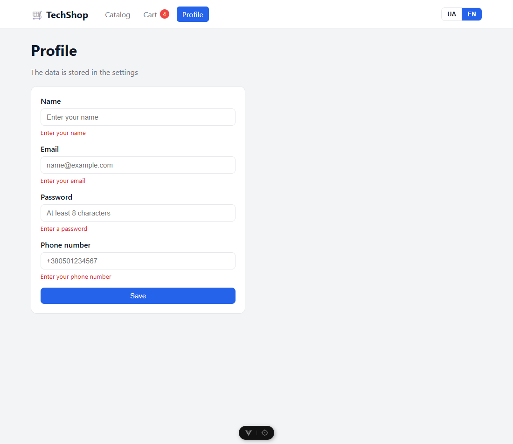
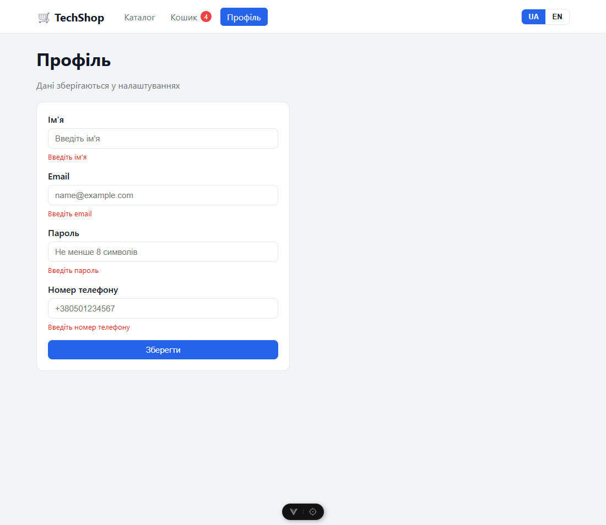
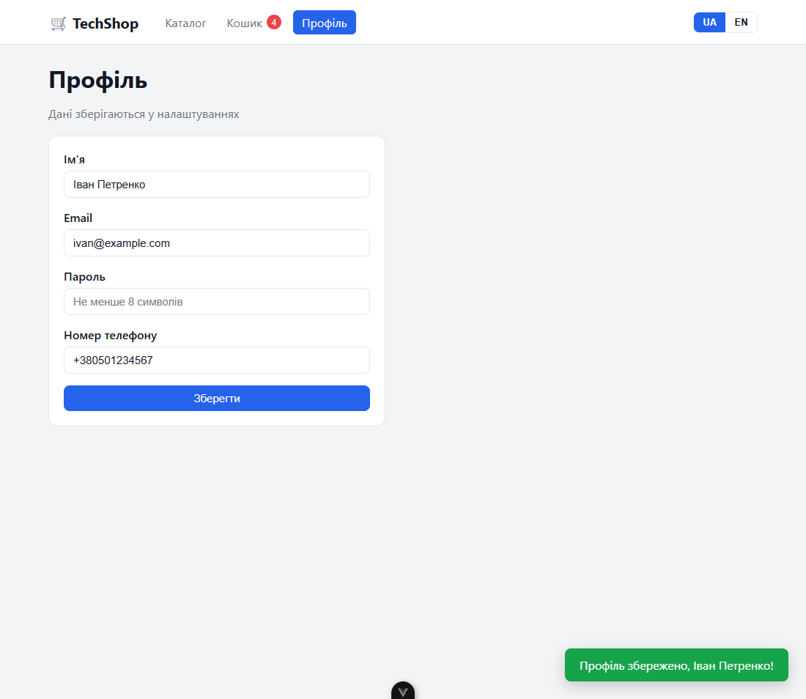
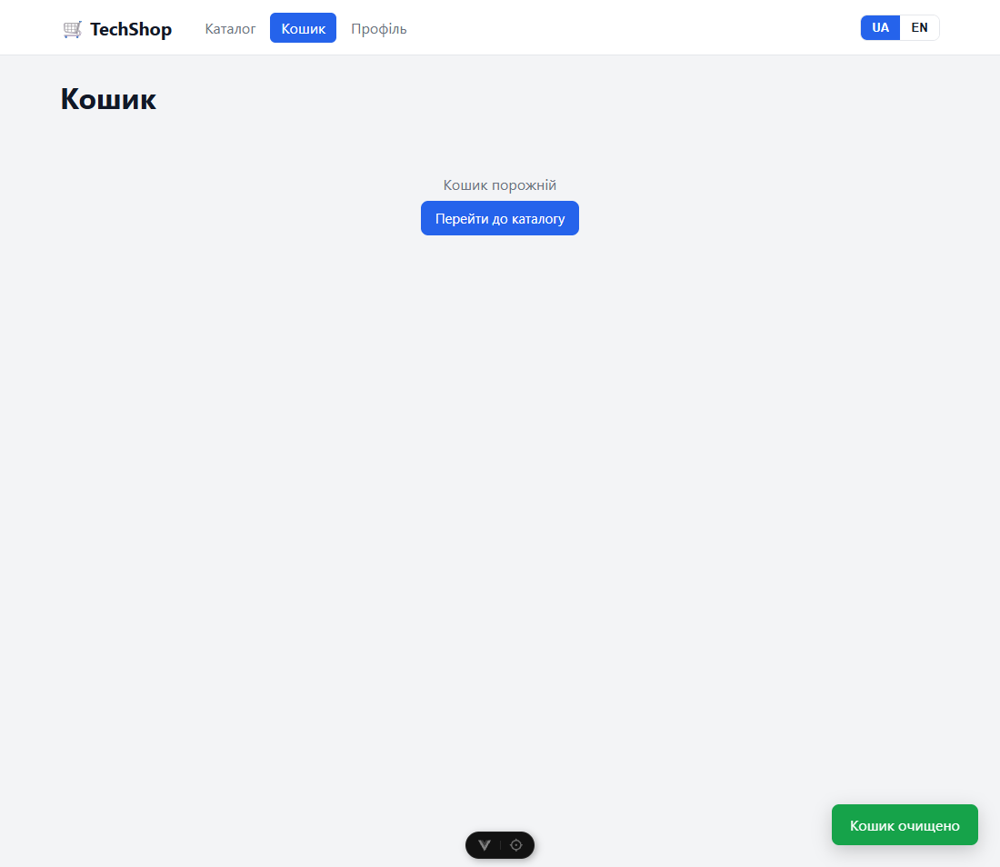

# Лабораторна робота №4. Управління станом (Pinia) та локалізація (vue-i18n)

Прототип інтернет-магазину TechShop на Vue 3 (Composition API), Pinia, vue-i18n та Vite. Є каталог товарів,
кошик, сторінка профілю з валідацією форми та перемикач мови (ua/en). Усі дані локальні, стан зберігається в
`localStorage` через `pinia-plugin-persistedstate`.

## Кроки запуску

```sh
cd lab4/vue-project
npm install
npm run dev
```

Застосунок відкривається на http://localhost:5173/ (порт може відрізнятись, його покаже Vite).

Збірка для production:

```sh
npm run build
```

## Стек

- Vue 3 (Composition API, `<script setup>`)
- Pinia 2 + pinia-plugin-persistedstate 3
- vue-i18n 10 (Composition API, `legacy: false`)
- Vue Router 4
- Vite

## Структура проєкту

```
src/
  main.js                    - createPinia, підключення плагінів, i18n та router
  i18n.js                    - createI18n, формати чисел, правила множини, модифікатор
  App.vue                    - шапка, перемикач мови, синхронізація Pinia <-> i18n
  stores/
    settings.js              - стор налаштувань (мова, дані профілю)
    cart.js                  - стор кошика
  locales/
    ua.js, en.js             - переклади
  pages/
    Catalog.vue              - каталог товарів
    Cart.vue                 - кошик
    Profile.vue              - форма профілю
    NotFound.vue
  components/
    LanguageSwitcher.vue     - перемикач UA / EN
    AppToast.vue             - сповіщення
  composables/useToast.js
  data/products.js           - список товарів
  router/index.js
```

## Реалізація

### Pinia

У `main.js` створюється `createPinia()`, до нього підключається `pinia-plugin-persistedstate`, після чого
викликається `app.use(pinia)`.

**Стор `settings`** (`src/stores/settings.js`):

- state: `locale` (`'ua' | 'en'`) та `profile` (`name`, `email`, `phone`);
- actions: `setLocale(lang)`, `saveProfile(data)`;
- `persist: true` - значення зберігаються в `localStorage` під ключем `settings`.

**Стор `cart`** (`src/stores/cart.js`):

- state: `items` - масив `{ id, title, price, qty }`;
- getters: `totalCount` (сума кількостей) та `totalPrice` (сума `price * qty`);
- actions: `add(product)` (додає товар або збільшує `qty`), `decrease(id)`, `remove(id)`, `clear()`;
- `persist: true` - кошик не втрачається після перезавантаження сторінки.

У компонентах стани дістаються через `storeToRefs`, щоб зберегти реактивність при деструктуризації
(`const { items, totalCount, totalPrice } = storeToRefs(cart)`), а дії викликаються напряму зі стора.

### vue-i18n

`src/i18n.js` створює екземпляр через `createI18n({ legacy: false, locale, fallbackLocale, messages })`.
`fallbackLocale: 'en'`. Додатково налаштовано:

- `numberFormats` - формат валюти `currency` для кожної мови (`42 999 грн` та `UAH 42,999`), використовується
  через `n(price, 'currency')`;
- `pluralRules` для української мови: «1 товар», «2 товари», «5 товарів» (повідомлення `cart.totalCount`
  з трьома формами, у англійській - з двома);
- `modifiers` - власний модифікатор `upper`.

Переклади лежать у `src/locales/ua.js` та `src/locales/en.js`: заголовки, кнопки, назви й описи товарів,
повідомлення про помилки валідації.

### Синхронізація Pinia і i18n

- При старті в `main.js` після підключення плагінів виконується
  `i18n.global.locale.value = settings.locale`, тому мова береться зі збереженого стору.
- У `App.vue` стоїть `watch` на `locale` зі стора (з `immediate: true`): при зміні мови в сторі оновлюється
  `locale` у `useI18n()` та атрибут `lang` на `<html>`.
- `LanguageSwitcher.vue` викликає `settings.setLocale('ua' | 'en')`, самого i18n напряму не змінює.




### Каталог

`Catalog.vue` виводить картки товарів із `src/data/products.js`: назва й опис беруться з перекладів за ключем
`products.<id>.title / description`, ціна форматується через `n()`. Кнопка «Додати до кошика» викликає
`cart.add(...)` і показує локалізований toast. Біля вже доданих товарів відображається кількість у кошику,
а в шапці - бейдж із `totalCount`.



### Кошик

`Cart.vue` показує таблицю товарів зі зміною кількості (`+` / `-`), видаленням позиції та кнопкою очищення
кошика. Усі рядки локалізовані, назви товарів підтягуються з перекладів (якщо ключа немає, використовується
збережена назва). Підсумки беруться з геттерів `totalCount` і `totalPrice`. Якщо кошик порожній, виводиться
повідомлення та посилання на каталог.




### Профіль

`Profile.vue` містить форму з полями ім'я, email, password та номер телефону. Правила валідації:

| Поле | Правило |
| --- | --- |
| Ім'я | обов'язкове, не менше 2 символів |
| Email | обов'язкове, формат `name@example.com` |
| Пароль | обов'язковий, не менше 8 символів, літери та цифри |
| Телефон | обов'язковий, формат `+380XXXXXXXXX` |

У `errors` зберігаються ключі помилок, а текст виводиться через `t('profile.errors.<ключ>')`, тому повідомлення
змінюють мову одразу при перемиканні, без повторної перевірки форми.




Після успішного сабміту ім'я, email та телефон зберігаються у стор `settings` (`saveProfile`), пароль у стор
не потрапляє, а форма показує локалізований toast.



### Персистентність

Після оновлення сторінки зберігаються мова, дані профілю та вміст кошика. Стан у `localStorage`:

```
settings = {"locale":"ua","profile":{"name":"Іван Петренко","email":"ivan@example.com","phone":"+380501234567"}}
cart     = {"items":[{"id":"p1","title":"Ноутбук Aurora 15","price":42999,"qty":2}, ...]}
```

